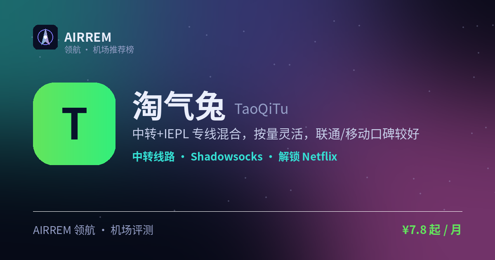

<p align="center"></p>

# 淘气兔机场评测 2026：联通移动用户，官网注册入口与套餐价格

> 一句话总结：中转+IEPL 专线混合，按量灵活，联通/移动口碑较好

<p align="center">
<a href="https://t.rtxk.us/t/ywcc7ms"></a>
<a href="https://air-rem.github.io/taoqitu/"></a>
</p>

👉 **[淘气兔 官网注册入口](https://t.rtxk.us/t/ywcc7ms)** ｜ [完整评测与横向对比](https://air-rem.github.io/taoqitu/)

---

## 基本信息

| 项目 | 内容 |
| --- | --- |
| 机场名称 | 淘气兔 |
| 成立时间 |  |
| 线路类型 | 中转 + IEPL 专线 |
| 支持协议 | Shadowsocks / Trojan |
| 流媒体解锁 | Netflix / ChatGPT |
| 节点地区 | 日本 · 香港 等（Amazon 中转为主） |
| 计费方式 | 包月 / 按量 |
| 起步价格 | ¥7.8 / 月 |
| 推荐场景 | 联通 / 移动用户要中转+专线混合 |


## 淘气兔是什么

淘气兔提供普通中转与 IEPL 专线两类线路，主打性价比与灵活按量，专注相对稳定快速的节点。

## 线路 · 协议 · 解锁

中转经 Amazon 日本转发，另有 IEPL 专线（约 2 倍率、线路更优）；支持 SS/Trojan，兼容主流客户端；联通、移动体验相对更好。

- 中转 + IEPL 专线可选
- 协议：SS / Trojan
- 联通/移动佳，电信部分地区可能限速

> 💡 粤、苏等地电信用户建议先小额测试再决定。


## 淘气兔 套餐价格

| 套餐 | 价格 | 说明 |
| --- | --- | --- |
| 小档 | ¥7.8 | 100GB/月 |
| 大流量 | ¥42 | 800GB/月 |
| 按量 100G | ¥22 | 一次性 / 不限时 |
| 按量 400G | ¥66 | 一次性 / 不限时 |

> 价格来自第三方清单，随时变动；建议优先月付，以官网为准。


## 优点与缺点

**✅ 优点**

- 普通中转性价比高
- 按量计费灵活
- IEPL 专线可选
- 联通/移动口碑较好

**⚠️ 缺点**

- 部分地区电信用户可能被 QoS 限速
- 机场行业存在跑路风险，建议先用月付或小额套餐验证稳定性，别一上来就大额年付。


## 适合谁 / 不适合谁

| 👍 适合 | 👎 不适合 |
| --- | --- |
| 联通、移动用户 | 粤、苏等地的电信用户（有限速反馈） |
| 需要灵活按量的中轻量用户 |  |


## 我们的结论

有普通中转与 IEPL 专线（2 倍率）两种选择，性价比不错；但电信用户（尤其粤/苏）可能遇 QoS 限速，非电信用户优先，先小额验证。


## 常见问题

**Q：淘气兔适合电信用户吗？**

A：部分地区电信可能遇限速，建议先小额测试实际体验。

**Q：按量还是包月？**

A：用量波动大选按量，长期稳定用选包月，以官网价格为准。


## 同类机场推荐

拿不定主意？可以再看看这几家同类型的：

- **[守候](https://air-rem.github.io/shouhou/)** — 稳健老用户 / Emby 影音，¥15 起
- **[自由猫](https://air-rem.github.io/freecat/)** — 日常主力，¥6 起
- **[边界云加速器](https://air-rem.github.io/lvpn/)** — AI 优化 + 稳定办公，¥9.97 起

全部 38 家机场的横向对比与选购方法论：**[AIRREM 领航 · 机场大全](https://air-rem.github.io/airports/)**


淘气兔 再好，也只是让你**连得上**。连上之后要用 Claude / GPT / Gemini，可以看看下面这个：

<p align="center">
<a href="https://i.rtxk.us/i/r37kbkg"></a>
<a href="https://i.rtxk.us/i/r37kbkg"></a>
<a href="https://guide.rtxk.us/tutorial/ai-coding/leonis-ai-cc-switch-guide.html"></a>
</p>

> ### 🦁 Leonis AI 中转站 —— 一个端点，抵达所有模型
>
> 机场解决「**连得上**」，[Leonis AI](https://i.rtxk.us/i/r37kbkg) 解决「**用得顺**」。把 **Claude、GPT、Gemini、Grok、Antigravity 等 6+ 模型** 统一成同一个 API 端点：**不改代码、不换客户端，只替换一行 Base URL**。
>
> - **原生工具直连**：Claude Code、Codex CLI、Cherry Studio、NextChat、OpenAI SDK 官方客户端直接用，不需要额外插件或魔改。
> - **全程流式不缓冲**：长回答边生成边吐字，不会卡到最后一次性蹦出来。
> - **多账号池调度**：后端多号轮询，单号被限流时自动顶上，稳定性更好。
> - **一个密钥全模型**：Claude、GPT、Gemini 共用一把 `sk-` 密钥，省心。
>
> ```bash
> export ANTHROPIC_BASE_URL=https://你的专属端点
> export ANTHROPIC_AUTH_TOKEN=sk-你的密钥
> claude
> ```
>
> OpenAI 兼容客户端填 `https://你的专属端点/v1`；也支持 cc-switch「导入到 CCS」一键导入。
> 邮箱注册几十秒，**注册即送体验额度** → **[免费注册 Leonis AI](https://i.rtxk.us/i/r37kbkg)** ｜ [cc-switch 接入教程](https://guide.rtxk.us/tutorial/ai-coding/leonis-ai-cc-switch-guide.html)

---

<sub>数据更新：2026-07 ｜ 价格、套餐与优惠码以官网实时为准 ｜ 本仓库为第三方评测整理，与 淘气兔 官方无隶属关系 ｜ 请遵守当地法律法规使用网络服务。</sub>

<sub>关键词：淘气兔、TaoQiTu、IEPL专线、按量机场、机场推荐</sub>
